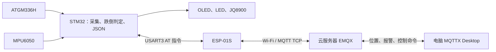

# MQTT 课程演示方案

日期：2026-10-26。适用基线：`0d35cd5`，C08 校时与 RTC 已完成，当前 C09 已实现，用户已确认验收通过，见 [C09验收](C09验收.md)。

本文为 C09 设计与联调约定；已实现内容和实际验证边界见 C09 验收文档，不代表 ESP 实物已验收。用户确认 EMQX 已重新部署，地址仍为 `114.55.210.224:1883`；桌面旧卸载说明不作为当前服务状态依据。当前账号密码以重新部署后的配置为准。

## 1. 展示目标和整体结构

展示四件事：定时上传位置和报警状态、跌倒即时通知、远程查询与消警、断网后自动恢复。



EMQX 负责认证、连接与消息转发；MQTTX 负责查看消息和发送命令；STM32 执行设备业务。MQTTX 的接收记录可用于答辩截图，EMQX 客户端列表可用于查看设备连接。用户随后增加网站需求，按[网站开发文档](网站开发文档.md)实施独立网页与后端，MQTTX 继续用于联调；网站复用本方案协议。

保持现有引脚、串口方式、跌倒规则和三个业务主题的用途；按用户本轮要求将主题前缀改为 `fallguard/`，保留设备编号 `belt01`。GPS 海拔、信号格、HDOP，MPU6050 加速度、角速度与角度继续在本地显示；本版 MQTT 只传位置、定位质量的基本标志和报警状态，不上传速度或高频原始 IMU 数据。

## 2. 连接参数

| 参数 | 方案 |
| --- | --- |
| Broker | `114.55.210.224` |
| 端口与传输 | `1883`，MQTT over TCP |
| MQTT 版本 | MQTT 3.1.1；MQTTX 手动选择同一版本 |
| ESP LinkID / scheme | `0` / `1` |
| 设备 ID / Client ID | `belt01` / `belt01` |
| MQTTX Client ID | `fallguard-mqttx-pc`；其他测试连接另取唯一名字 |
| 认证 | 用户名和密码，使用当前部署中的 MQTT 账户 |
| Keep Alive | 120 秒，由 ESP MQTT 客户端处理心跳 |
| Clean Session | 开启；每次重连重新订阅 |
| QoS | 三个主题的发布和订阅均使用 0 |
| Retain | 所有业务发布均为 false |
| 默认上报周期 | 5 秒；下行允许 1～3600 秒，单位为秒 |
| 配置保存 | 周期只在 RAM 保存，MCU 重启恢复 5 秒，网络重连保留当前值 |
| 自动恢复 | STM32 状态机管理重连，ESP `MQTTCONN` 的 reconnect 参数为 0 |

TCP 1883 沿用用户已接受的课程演示选择，会明文传输账户和数据。ESP8266 对应 v2.2 官方 AT 文档注明 MQTT TLS 不受支持；不因 MQTTX 支持 TLS 就把 ESP 连接改为 8883。[ESP8266 官方 MQTT AT 文档](https://docs.espressif.com/projects/esp-at/en/release-v2.2.0.0_esp8266/AT_Command_Set/MQTT_AT_Commands.html)

QoS 0 方便保持实现简洁，但不保证每条事件送达。周期消息中的 `st` 持续反映当前报警状态，可在单次报警事件丢失后仍看到设备处于报警中；它不能恢复已结束的历史事件。MQTTX 发送记录、AT 返回 `OK`，都不能证明设备已经执行命令，须观察设备动作或后续上报。

本版不增加遗嘱、在线状态主题或命令应答主题。设备是否连接看 EMQX 的 `belt01` 客户端；最近一次业务数据何时到达看 MQTTX 的接收时间。上报周期可调到 3600 秒，所以不能用固定“若干秒没收到位置”直接判断离线。

## 3. 主题与权限

| Topic | 发布方 → 订阅方 | 内容 |
| --- | --- | --- |
| `fallguard/belt01/loc` | 设备 → MQTTX | 位置、时间、定位标志、当前报警状态 |
| `fallguard/belt01/alarm` | 设备 → MQTTX | 跌倒/手动测试报警事件、消警事件 |
| `fallguard/belt01/cmd` | MQTTX → 设备 | 查询位置、消警、修改周期 |

主题区分大小写，完整业务主题不带开头或末尾斜杠。`fallguard/` 只是前缀写法，单独订阅它仅匹配该字面主题，不匹配子主题；`fallguard/#` 才订阅此前缀下的所有层级。设备只订阅精确的 `fallguard/belt01/cmd`。电脑展示时订阅 `fallguard/#`，可以看到整个项目的消息；只看一台设备可订阅 `fallguard/belt01/#`；需要只看设备上行时，分别订阅 `loc` 和 `alarm`。

课程版可共用一个非超级用户 MQTT 账户，只允许其发布/订阅 `fallguard/#`，其他主题拒绝。现有账号名称可直接沿用；`mqtt_user` 仅可作为配置示例，不视为已经确认的新账户。无需为了演示新增数据库认证、集群或独立权限服务。

EMQX 需要具备：TCP 1883 监听、正确的账号密码认证，以及上述主题授权。认证通过只代表可连接，授权决定能否发布和订阅；检查实际授权链中是否有更早的放行/拒绝规则。[EMQX 认证](https://docs.emqx.com/en/emqx/latest/guides/access-control/authn/authn.html)、[EMQX 授权](https://docs.emqx.com/en/emqx/latest/guides/access-control/authz/authz.html)

正常 Retain=false 不会清除服务器以前保存的保留消息。联调前检查三个主题是否存在旧保留消息，尤其是 `cmd`；如有，先人工确认并清理该主题的历史保留消息，再接入设备，避免旧消警/改周期命令在订阅时执行。Clean Session 不会清除保留消息。

## 4. 上行 JSON

沿用开发文档的字段名。实际载荷为一个 UTF-8 JSON 对象，无注释、不附额外协议头；当前取值全部使用 ASCII，便于检查长度。

### 4.1 位置与当前状态

Topic：`fallguard/belt01/loc`

```json
{"id":"belt01","ts":0,"lat":22615755,"lon":114141317,"fix":1,"st":"ok"}
```

| 字段 | 类型与含义 |
| --- | --- |
| `id` | 字符串，固定 `belt01` |
| `ts` | 非负整数，设备采样快照时的 Unix UTC 秒；RTC 未校准为 0 |
| `lat` | 有符号整数微度；示例为北纬 22.615755° |
| `lon` | 有符号整数微度；示例为东经 114.141317° |
| `fix` | 整数 0/1；GPS 当前有效位置标志，包含已确认的 5 秒过期规则 |
| `st` | 字符串 `ok` 或 `fall`，表示报警锁定是否生效，不代表全部传感器健康状态 |

按用户最新说明，MQTT 不上报卫星数，载荷不包含 `sat`；卫星数仅保留硬件本地展示，网站不额外要求该字段。

例子中的 `ts=0` 专门展示“位置有效、RTC 尚未校准”可以同时成立。正常校时后发送实际 UTC 时间戳，不把东八区本地秒数当成 UTC。

位置无效或过期时 `fix=0`，保留最近一次有效经纬度；从未定位时发送 `lat=0, lon=0, fix=0`。收到 `fix=0` 不应将坐标视为新定位，不能把 (0,0) 标成真实位置。

上报触发：首次连接且订阅成功后立即一次；之后按周期发送；收到 `loc` 命令后尽快一次；报警状态改变后尽快更新一次；重连后立即发送当前快照。重合的普通位置请求可合并，避免一次循环重复发送同样内容。

### 4.2 报警事件

Topic：`fallguard/belt01/alarm`

```json
{"id":"belt01","ts":0,"ev":"fall","lat":22615755,"lon":114141317,"fix":1}
```

从非报警进入锁定报警时发送一次。自动倾斜触发和 K2 手动测试沿用同一种 `fall` 事件，不增加来源字段。设备仍按已确认的规则执行：任一角度绝对值达到 60° 连续 1 秒锁定报警，语音和 LED 同时工作；保持倾斜不会每次采样重复发事件。

事件中的时间、位置、定位有效性取发生时快照；发送排队时不改成之后的位置。进入报警后，周期 `loc` 持续携带 `st="fall"`。

### 4.3 消警事件

Topic：`fallguard/belt01/alarm`

```json
{"id":"belt01","ts":0,"ev":"cancel"}
```

本地 K2 或有效远程 `clear` 使报警解除时发送一次，并尽快上报 `st="ok"` 的位置快照。消警后仍须两角均小于 60° 才重新允许自动报警，保持现有等待扶正语义。

## 5. 下行控制

全部发布到 `fallguard/belt01/cmd`，QoS 0，Retain=false。一次只发一个对象。

| 载荷 | 设备行为 | 如何确认 |
| --- | --- | --- |
| `{"cmd":"loc"}` | 请求尽快上报一条最新位置和状态，不等待下一周期 | MQTTX 收到新的 `loc`；GPS 无效也要回复当前快照 |
| `{"cmd":"clear"}` | 仅在正在报警时解除报警、停止语音并进入等待扶正；未报警则保持原状 | 报警时收到一次 `cancel`，后续 `st="ok"`，本地语音停止 |
| `{"cmd":"intv","v":1}` | 设置位置上报周期为 1 秒 | 观察后续 `loc` 间隔约 1 秒 |
| `{"cmd":"intv","v":5}` | 恢复默认的 5 秒周期 | 观察后续 `loc` 间隔约 5 秒 |
| `{"cmd":"intv","v":3600}` | 设置为每小时上报，仍可用 `loc` 立即查询 | 查看设备调试日志；演示前恢复 5 秒 |

`intv` 只接受 1～3600 的整数，修改后从处理命令时重新计周期，不写 Flash，也不改变报警事件的即时发送。遥控 `loc` 不改周期。重复 `clear` 不触发新报警，也不反复发 `cancel`；重复 `intv` 只设置同一值。这些命令没有额外 JSON 应答，调试串口应记录命令是否接受及当前周期。

完整载荷最长 127 字节，另留 1 字节 NUL。允许空白及 `cmd`/`v` 键顺序交换；仅接受上述固定字段组合，拒绝重复字段、未知命令/字段、缺少参数、截断对象、尾随垃圾、嵌入 NUL 和非法类型。`v` 不接受字符串、小数、指数、正负号或前导零；无效命令只记录，不改变状态。

需拒绝的例子：

```json
{"cmd":"intv","v":0}
{"cmd":"intv","v":3601}
{"cmd":"intv","v":"5"}
{"cmd":"intv","v":1.5}
{"cmd":"intv"}
{"cmd":"unknown"}
```

MQTTX 同时订阅 `fallguard/#` 时，会收到自己发布的 `cmd`。那是 Broker 转发回来的命令原文，不是设备执行应答。

## 6. 启动、断网和恢复

启动顺序：现有本地初始化 → AT 探测/关闭回显 → Wi-Fi → SNTP 有限尝试 → MQTT 连接 → 订阅 `cmd` → 立即上报当前状态 → 周期运行。

只有 MQTT 已连接并且命令主题订阅成功，才将业务连接标为在线并允许上报。Wi-Fi 获得 IP 不等于 MQTT 在线，SNTP 成功也不等于 MQTT 在线。

| 情况 | 处理 |
| --- | --- |
| SNTP 30 秒窗口内未获得有效时间 | 保留已有 RTC；未校准则 `ts=0`，继续建立 MQTT，后续安排校时 |
| Wi-Fi/MQTT 断开 | 本地采样、跌倒判定、语音、按键、OLED 继续工作 |
| 离线时发生 `fall`/`cancel` | 不排队补报历史事件；设备保留当前真实报警状态 |
| 恢复连接 | 重新订阅 `cmd`，立即发送当前位置与当前 `st`，不伪造新的历史 `fall` |
| 离线时报警后又消警 | 重连只发当前 `st="ok"`，看不到这次已结束的离线报警过程 |
| MCU 重启 | 周期回到 5 秒；本地报警状态沿用现有初始化方式，不声称可恢复重启前的报警历史 |
| 连续控制/事件到达 | 同一时间只执行一个 AT 事务，已发生的在线事件优先于普通位置上报 |

在线事件可用 4 项固定 FIFO 保存短暂 AT 忙期间的发生快照，断线时清空；满时不覆盖已有事件，记录丢弃计数，周期 `st` 仍反映当前状态。这是有限 RAM 排队，不是离线历史存储。

重连等待沿用 30 秒，不能在主循环里阻塞等待。AT 命令超时或串口丢帧导致事务边界不可信时，停止当前事务，走已有 ESP EN 复位和重新配置路径；不能把后续迟到的 `OK` 算成下一条命令成功。具体 MQTT 连接超时根据实物确定，初始设计连接 30 秒、其余 MQTT 事务 10 秒。

Keep Alive 120 秒不表示断电后服务器立刻显示离线；网络故障的发现还受心跳、TCP 和服务器超时影响，验收不承诺“断网后一秒内显示离线”。

## 7. STM32 / ESP 实现边界

### 7.1 模块分工

| 文件 | 后续 C09 工作 |
| --- | --- |
| `BSP/bsp_esp.c/h` | 扩展现有非阻塞 AT 状态机：MQTT 配置、连接、订阅、发布、URC 和重连 |
| `BSP/mqtt_config.example.h` | 无真实密码的配置模板 |
| `BSP/mqtt_config_local.h` | 本地地址、端口、账号密码；加入 Git 忽略规则 |
| `App/app_json.c/h` | 固定缓冲区生成上行；解析完整且 NUL 结尾的下行对象 |
| `App/app_report.c/h` | 周期、状态变化、事件 FIFO、下行执行与快照调度 |
| `App/app_main.c` | 接入轮询，不改变现有采样、按键和语音功能 |
| `App/app_ui.c` / `BSP/debug_config.h` | 显示 MQTT/Wi-Fi 状态，集中控制网络与上报日志 |

不使用 malloc、DMA、RTOS 或浮点 printf。UART ISR 只收字节和处理接收恢复；主循环按载荷声明长度拆帧后，才交给 App 解析 JSON。

### 7.2 AT 交互

以下为串口实际文本模板，行尾为 CR-LF。占位符须替换，账户密码不得写进公开文档或普通日志。

```text
AT+MQTTUSERCFG=0,1,"belt01","<MQTT用户名>","<MQTT密码>",0,0,""
AT+MQTTCONNCFG=0,120,0,"","",0,0
AT+MQTTCONN=0,"114.55.210.224",1883,0
AT+MQTTSUB=0,"fallguard/belt01/cmd",0
```

`CONNCFG` 第三个参数为 0 表示开启 Clean Session。串行发送，一条事务处理完再发下一条；连接要处理匹配的 `+MQTTCONNECTED` 与最终结果，订阅确认后才进入业务在线。初始化需要清理旧会话时使用 `AT+MQTTCLEAN=0`。[ESP MQTT 连接参数](https://docs.espressif.com/projects/esp-at/en/release-v2.2.0.0_esp8266/AT_Command_Set/MQTT_AT_Commands.html#at-mqttconncfg-set-configuration-of-mqtt-connection)

采用普通 `AT+MQTTPUB`，本版短 JSON 可放入其命令长度限制，不额外引入 RAW 发送阶段。完整位置例子：

```text
AT+MQTTPUB=0,"fallguard/belt01/loc","{\"id\":\"belt01\"\,\"ts\":0\,\"lat\":22615755\,\"lon\":114141317\,\"fix\":1\,\"st\":\"ok\"}",0,0
```

`app_json` 生成原始 JSON，`bsp_esp` 单独执行 AT 参数转义：JSON 内的反斜杠、双引号、逗号分别编码为 `\\`、`\"`、`\,`。MQTTX 输入的是原始 JSON，不粘贴 AT 转义后的字符串。

按项目 PDF 第 204～213 页和第 244 页检查语法及转义。256 字节发送缓冲最多放 255 字节实际串口文本，另留 NUL；本方案保守要求包含 CR-LF 的整条 AT 文本小于 256 字节，检查 `snprintf` 返回值和转义后的长度，超长拒绝发送，不能截断。

下行示例：

```text
+MQTTSUBRECV:0,"fallguard/belt01/cmd",13,{"cmd":"loc"}
```

`13` 是载荷字节数。按长度收取恰好 13 字节，再补 NUL。一次串口中断、一次主循环或一行文本都不等同于一个 MQTT 消息；必须处理分片、连续帧及 URC/普通应答交错。超长载荷按声明长度丢弃；长度不可信、超时或环形缓冲溢出后，进入明确的会话恢复路径。

## 8. MQTTX Desktop 配置

使用桌面版 MQTTX。TCP 1883 不需要配置 WebSocket 路径。

| 界面项 | 填写值 |
| --- | --- |
| Name | `Fallguard 展示` |
| Client ID | `fallguard-mqttx-pc`，不能与设备的 `belt01` 相同 |
| Host | 协议选择 `mqtt://`，主机填写 `114.55.210.224` |
| Port | `1883` |
| Username / Password | 当前部署中的 MQTT 账户密码，不是 Dashboard 管理员密码 |
| SSL/TLS | 关闭 |
| MQTT Version | `3.1.1`，注意 MQTTX 默认可能为 5.0 |
| Clean Session | 开启 |
| Keep Alive | `120` |
| 自动重连 | 开启 |
| Last Will | 留空 |

连接后 New Subscription 添加 `fallguard/#`，订阅 QoS 0。发布区选择 JSON，Topic 为 `fallguard/belt01/cmd`，QoS 0，Retain 关闭，按第 5 节逐条发送。MQTTX 的接收/发布、版本、Client ID 等设置可参考[官方入门文档](https://mqttx.app/docs/get-started)。

### 8.1 先验证服务器转发

设备尚未接入时，可创建第二个 MQTTX 连接：名称 `Fallguard 模拟设备`，Client ID `belt01-sim`，其余连接参数相同。真实设备此时先断开，避免把模拟数据误认为实测。

1. 展示连接订阅 `fallguard/#`；模拟设备连接只订阅 `fallguard/belt01/cmd`。
2. 模拟设备向 `loc` 发布第 4.1 节的 JSON，展示连接应收到相同内容。
3. 模拟设备向 `alarm` 发布 `fall`，再发布 `cancel`，展示连接应按序收到。
4. 展示连接向 `cmd` 发送 `{"cmd":"loc"}`，模拟设备连接应收到。
5. 完成后断开模拟设备连接，再进行真实硬件联调。

以上只验证账号、授权和服务器双向转发。模拟连接不会自动解析命令或模拟传感器，也不能证明 STM32 已完成 C09。

### 8.2 真实设备验收

| 顺序 | 操作 | 通过标准 |
| --- | --- | --- |
| 1 | 连接 MQTTX，启动设备 | EMQX 有 `belt01`；设备完成命令订阅后立即收到 `loc` |
| 2 | 等待 3 条周期数据 | 默认间隔约 5 秒；JSON 字段、整数经纬度和时间有效性符合定义 |
| 3 | 室内无 GPS 定位 | 仍能收到 `fix=0` 的快照，设备不因无定位阻塞 MQTT |
| 4 | 发布 `{"cmd":"loc"}` | 不等满下一周期即可收到快照；串口显示命令被接受 |
| 5 | K2 手动报警 | 语音工作，收到一次 `fall`，后续 `loc` 为 `st="fall"` |
| 6 | 发布 `{"cmd":"clear"}` | 语音停止，收到一次 `cancel` 和更新的 `st="ok"` |
| 7 | 再次发送 `clear` | 不触发报警、不重复消警事件；串口可显示幂等处理 |
| 8 | 板子扶正后缓慢放倒，超过 60° 持续 1 秒 | 自动报警、上报一次 `fall`；保持倾斜不反复发事件 |
| 9 | 倾斜时远程消警，保持不扶正 | 不再次自动报警；扶正后重新放倒可再次触发 |
| 10 | 改 `intv` 为 1，再改回 5 | 上报间隔相应变化，报警事件仍立即调度 |
| 11 | 发送第 5 节无效命令 | 周期和报警状态不改变，程序正常运行 |
| 12 | 断开设备 Wi-Fi，操作 K2 报警/消警 | 本地功能正常；恢复后立即收到当前快照，无离线历史事件补发 |
| 13 | 重启 MCU | 连接和订阅恢复，周期回到 5 秒；RTC 结果按 C08 实际备份供电情况记录 |

“立即”指下一次可用 AT 事务尽快发送，不能抢占正在进行的事务或承诺严格端到端时延。保存 MQTTX 接收时间和串口日志，记录实际值；没有收到硬件数据前不填写“通过”。

## 9. 常见问题与定位顺序

| 现象 | 优先检查 |
| --- | --- |
| MQTTX 连接不上 | IP、1883 监听、云安全组/主机防火墙、当前用户名密码、TCP/TLS 是否选错 |
| 能连上但收不到数据 | 订阅成功与授权、topic 拼写、设备是否完成订阅、是否误把发布记录当成接收 |
| 两端轮流掉线 | Client ID 是否重复，MQTTX 不得使用 `belt01` |
| 发布 `cmd` 看到原文却没动作 | 自订阅回显不是执行应答；查看 ESP 接收 URC、载荷长度与 App 命令日志 |
| 坐标为 0 / ts 为 0 | 分别检查 `fix` 和 RTC 校准；两者不应阻止上报 |
| 重连后执行旧命令 | 检查命令主题上的历史 Retain 消息，而不只检查 Clean Session |
| 发送失败或 JSON 异常 | 检查 AT 特殊字符转义、整条命令长度、固定缓冲截断和 UART 丢字节 |

## 10. 实施与交付范围

本方案已用于当前 C09 的 MQTT/JSON/重连实现。Debug 与回放已通过，电脑端当前云 Broker 收发复测通过；用户已确认 C09 验收通过；上述步骤保留用于后续回归。没有修改服务器或 MQTTX 配置，C10 和网站仍单独推进。

相比基线开发文档，本文按用户要求将原 `belt/` 主题前缀统一改为 `fallguard/`，保留设备编号、命令和跌倒语义，按用户说明去掉未上报的 `sat` 字段，采用用户后来确认的默认 5 秒/1～3600 秒及断网不补报规则。开发文档中的旧周期和待定 broker 描述已同步更新。
