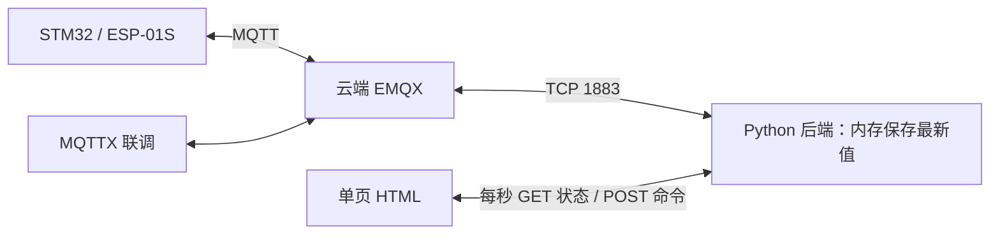

# Fallguard 网站开发文档（简易展示版）

版本：2.0；日期：2026-10-26。按用户最新要求精简：网站仅用于课程基本展示，不是项目重点。本版替代此前包含登录、数据库、历史管理和多页面的方案。

配套：[MQTT 课程演示方案](MQTT课程演示方案.md)、[网站 Agent 提示词](网站Agent提示词.md)。本文只规定后续网站实现，当前未创建网站；固件已在 C08 `0d35cd5` 基线上接入 C09，用户已确认 MQTT 阶段通过，记录见 [C09验收](C09验收.md)。

## 1. 做到什么程度

打开一个页面，能够看见腰带的位置与报警状态，并演示三个已有 MQTT 命令即可。默认只展示 `belt01`，以后需要换设备时修改后端配置，不开发设备管理。

| 保留功能 | 展示内容 |
| --- | --- |
| 基本信息 | 设备 ID、网站后端 MQTT 是否连接、最近收到数据的时间 |
| 定位 | 经纬度、fix；有有效位置时地图打点 |
| 时间 | 设备时间；ts=0 显示未校准；另显示电脑/服务器接收时间 |
| 报警 | 当前 st 状态、最近 fall/cancel 提示，报警时用醒目的红色文字和区域 |
| 三个操作 | 查询位置、远程消警、设置 1～3600 秒上报周期 |
| 最近消息 | 内存中最多 20 条接收消息，便于演示和排错，刷新页面仍可从后端读取 |

不做登录、用户权限、数据库、历史查询、报表、轨迹、设备增删、复杂图表、消息导出或后台管理。最近消息仅保存在后端内存，后端关闭即丢失，不能称为持久历史记录。

不做内置模拟系统。实物未接入时，用 MQTTX 手动发送文档中的 JSON 验证页面；这类测试明确记为 MQTTX 注入，不能写成实物验收。

## 2. 最简单的实现结构

采用 **普通 HTML + CSS + JavaScript 页面，Python FastAPI + paho-mqtt 作为小型后端**。不使用 Vue/React、Vite、npm 构建、SQLite、SSE 或 WebSocket；浏览器每秒请求一次最新状态即可。



后端同时提供网页文件和三个接口，前后端同源。浏览器不直接连接 MQTT，也不接收 MQTT 密码。MQTT Client ID 使用 `fallguard-web-server`，避免与设备和 MQTTX 重复。

默认在电脑本机 `127.0.0.1:8000` 运行，浏览器直接访问该地址。EMQX 继续使用云服务器 `114.55.210.224:1883`，不用改造当前 Broker。若要在云服务器运行网站，仍可绑定本机地址并通过 SSH 本地转发访问；本次不要求公网网站、域名、证书、Nginx 或 systemd 配置。

## 3. 页面设计

只做一个页面，无导航栏、路由、登录页和管理菜单。

```text
Fallguard 定位与报警展示              设备：belt01
网站 MQTT：已连接 / 连接中 / 已断开   最近消息：3 秒前
--------------------------------------------------------
报警状态：正常 / 报警 / 暂无状态快照
最近事件：收到报警 / 收到消警 / 暂无事件
--------------------------------------------------------
地图或位置区域                       数据
有效位置标记                         纬度、经度
无定位/历史位置提示                   定位有效性
                                     设备时间、接收时间
--------------------------------------------------------
[查询位置] [远程消警]  周期：[5] 秒 [发送设置]
操作提示：已发送，设备执行未确认
--------------------------------------------------------
最近消息（最多 20 条，接收时间、类型、简短内容）
```

中文界面，浅色背景、清晰文字、蓝色操作按钮、红色报警区；报警文字不能只靠颜色区分。电脑和手机基本可用，不横向溢出。页面启动先显示“等待设备上报”，不填假的坐标或默认正常状态。

默认周期输入 5 秒只是项目约定值。用户发送新周期后显示“最近请求：X 秒”，不把它写成“设备当前周期”，因为当前协议没有周期回传。

查询和设置点击一次只发一次，请求期间禁用对应按钮。消警用一个简单确认框，确认后发送 clear；重复 clear 不应被网页转换成测试报警。无需弹窗堆叠、复杂通知系统或浏览器声音报警。

## 4. MQTT 对接

配置从后端本地 `.env` 读取；提交空值模板 `.env.example`，真实密码不入 Git，也不写入 HTML/JS。MQTT 账户使用重新部署后的当前值，不猜测旧密码。

| 参数 | 值 |
| --- | --- |
| Broker | `114.55.210.224:1883` |
| 协议 | MQTT 3.1.1，用户名密码认证 |
| 设备 | 默认 `belt01` |
| 订阅 | `fallguard/belt01/loc`、`fallguard/belt01/alarm` |
| 发布 | `fallguard/belt01/cmd` |
| QoS / Retain | 0 / false |
| Clean Session / Keep Alive | true / 120 秒 |

后端订阅主题由配置的 DEVICE_ID 生成；不订阅 cmd，防止把命令回显当作设备回复。重连后重新订阅，订阅失败应明确显示未就绪。

位置载荷：

```json
{"id":"belt01","ts":0,"lat":22615755,"lon":114141317,"fix":1,"st":"ok"}
```

报警和消警载荷：

```json
{"id":"belt01","ts":0,"ev":"fall","lat":22615755,"lon":114141317,"fix":1}
{"id":"belt01","ts":0,"ev":"cancel"}
```

用户已说明 MQTT 未上报卫星数，网站不要求 `sat` 字段；硬件本地仍可显示卫星数。

三个下行载荷：

```json
{"cmd":"loc"}
{"cmd":"clear"}
{"cmd":"intv","v":5}
```

不修改现有 topic、字段和命令，不增加固件 ACK 或网页专用字段。设备下行周期仍为整数 1～3600 秒、默认 5 秒；断网不补报设备历史事件的规则保持不变。

## 5. 几条必须准确的显示规则

1. 经纬度为整数微度，显示时除以 1000000；地图使用 WGS84，Leaflet 参数顺序为 `[纬度,经度]`。
2. fix=0 表示当前定位无效。已有最近有效位置可保留标记，但标注“历史位置”；从未定位的 (0,0) 不落点。后端刚启动只收到 fix=0 的保留坐标时，可显示坐标文字并注明采集时间未知，不冒充新定位。
3. ts=0 显示“设备时间未校准”，不显示 1970 年；服务器接收时间照常显示。日期显示为东八区，原始设备时间戳保持 UTC 含义。
4. 最新 loc.st 是设备状态快照。fall/cancel 单独显示最近事件；如收到 cancel 但旧快照仍为 fall，提示“已收到消警事件，等待状态更新”。只有事件而没有 loc 时，状态快照仍为未知。
5. 显示“网站 MQTT 已连接”，不要写成“设备已在线”。没有独立在线主题，且周期可达 3600 秒，不能用固定 15/30 秒无消息判设备离线。
6. “已发送”仅表示命令交给 MQTT 网络发送，不等于设备执行成功。后续 loc/cancel 可作为人工观察依据，不能伪造关联 ACK。
7. 当前协议没有卫星数、电量、GPS 信号强度、海拔、HDOP、姿态角，网页不显示这些实时数值，也不根据 fix 推算卫星数或信号强度。
8. 后端 MQTT 断开时保留已有数据并标注旧数据，禁止继续发送真实命令；页面取状态失败时提示“网页与后端连接中断”，不能继续假装刷新。

地图采用 Leaflet + OpenStreetMap，只做单点展示，保留署名；底图网络失败时仍显示坐标和控制按钮。允许使用 CDN 加载地图库，但应说明需要网络；地图不影响核心数据展示。不做批量下载或离线瓦片。[Leaflet 入门](https://leafletjs.com/examples/quick-start/)、[OSM 瓦片规则](https://operations.osmfoundation.org/policies/tiles/)

## 6. 后端与接口

### 6.1 内存处理

一个后端进程、一个 Paho MQTT 客户端，使用 Callback API VERSION2 和 loop_start，FastAPI lifespan 负责启动和关闭。Paho 回调内只做短小的载荷校验和内存更新，不阻塞等待、不执行网络查询；共享状态使用一把短时间持有的线程锁，GET 接口在锁内复制后再返回。[Paho 文档](https://eclipse.dev/paho/clients/python/docs/)、[FastAPI lifespan](https://fastapi.tiangolo.com/advanced/events/)

内存保存 MQTT/订阅状态、最新 loc、最近有效位置、最近 alarm、最近一次命令发送结果，以及最多 20 条消息。使用有上限的 deque，不保存无限日志。不建数据库，也不增加跨线程消费架构。

仅接受配置设备的两个主题，检查 topic 与 id 一致、字段类型与范围。原始载荷上限 1024 字节，拒绝非法 UTF-8、错误 JSON、重复键和非有限数字。经纬度、ts、fix 必须是真正整数而非 bool；ts 为 0～4294967295，纬度 ±90000000、经度 ±180000000，fix=0/1，st=ok/fall，ev=fall/cancel。坏消息只记录一条简短诊断，不覆盖好数据，不使服务退出。

收到 Retain=true 的消息应注明“保留消息/历史数据”，不把接收时间当作一次新的设备上报，不作为新实时报警弹出；正常设备上报要求 Retain=false。

### 6.2 三个接口

| 接口 | 作用 |
| --- | --- |
| GET `/` | 返回单页网页，静态 CSS/JS 放在 `/static/` |
| GET `/api/state` | 返回设备 ID、MQTT/订阅状态、最新 loc、位置/事件、最近接收时间、最近命令结果和 20 条消息 |
| POST `/api/command` | 接受 loc/clear/intv，向配置设备的 cmd 主题发送 |

页面每秒请求一次 state，前一个请求完成后再安排下一次，设置请求超时，避免网络慢时叠加。轮询只读内存，不会每秒发送 MQTT 查询或提高硬件上报频率。

命令请求沿用 MQTT 命令对象。后端不接受任意 topic、不接受网页指定其他设备 ID。参数不合法返回 422，MQTT/订阅未就绪返回 503；断开期间不缓存命令、不在重连后重发旧 clear。不要自动重试 POST。

有效请求返回 202 和“正在发送”。Paho 的 MessageInfo 用于检查发送进度，明确完成后更新为“已发送，设备执行未确认”；断开/超时则显示失败或结果未知。GET state 也返回此结果供页面轮询。publish 的返回成功不能直接当作设备执行成功，不必为此实现复杂命令任务系统。

## 7. 文件和启动方式

```text
web/
  README.md
  requirements.txt       # fastapi、uvicorn、paho-mqtt、python-dotenv
  .env.example
  .env                   # 本地配置，Git 忽略
  main.py                # 配置、MQTT、内存状态、三个接口
  static/
    index.html
    style.css
    app.js
```

代码短时直接按上述结构实现，不提前拆很多模块。后续实现时锁定依赖版本。main.py 不在 import 时连接 Broker，由 lifespan 管理。

配置模板：

```dotenv
MQTT_HOST=114.55.210.224
MQTT_PORT=1883
MQTT_USERNAME=
MQTT_PASSWORD=
MQTT_CLIENT_ID=fallguard-web-server
DEVICE_ID=belt01
```

README 需要提供 Windows PowerShell 和 Ubuntu 的虚拟环境、安装依赖、复制配置及启动步骤。基本启动命令为 `uvicorn main:app --host 127.0.0.1 --port 8000 --workers 1`，从 web/ 执行。main.py 读取本地 .env；一个 worker 即可，不开多进程重复订阅。

不需要前端打包命令，不需要申请域名或安装数据库。实际开发仅写 web/、必要的忽略规则和说明，不改固件、.ioc、CMake，不修改现有 EMQX 服务。本版没有登录和权限控制，按默认本机展示方式运行，不自动开放公网控制接口。

## 8. 最小实施顺序

| 阶段 | 产出 |
| --- | --- |
| W01 | main.py、静态页面、配置模板；本地打开页面，空态正确 |
| W02 | MQTT 收取与内存状态、1 秒轮询、地图/坐标、报警和最近消息；MQTTX 注入可见 |
| W03 | 三个命令、异常提示、README；MQTTX 验证发布内容，查看电脑与手机页面 |

网站不是固件重点，达到这些要求即可，不继续扩展成管理平台。不恢复前一版登录/数据库/SSE 设计。

## 9. MQTTX 验收

1. MQTTX 连接相同 Broker，Client ID 与设备/网站均不同，订阅 `fallguard/#`，QoS 0、Retain=false。
2. 向 loc 发本文件例子，网页在下一次成功轮询后显示正确坐标、fix 和未校准时间；有有效位置时地图落点。
3. 发 fall 和 st=fall 的 loc，网页显示报警；发 cancel 和 st=ok 的 loc，提示和状态相应更新。
4. 点击三个操作，MQTTX 分别收到精确的 loc、clear、intv 对象；0、3601、小数和字符串周期被拒绝。
5. 发 fix=0、(0,0)、非法 JSON、topic/id 不匹配，检查无虚假定位、无服务崩溃。
6. 后端断开 Broker，页面显示连接异常并保留旧数据；命令拒发，重连后恢复订阅。
7. 重启后端，最近消息清空、页面等待新数据；不承诺持久历史。关闭后端后页面提示连接中断。
8. 地图失败仍能看数据、发命令；电脑与手机不溢出。查看静态文件确认没有 MQTT 密码。

先做 Python 语法检查和关键消息/周期校验，再实际打开浏览器验证。只有文档修改时无需编译 STM32。交付区分“页面验证”“MQTTX 注入”“实物联调”，没有实际执行的项目写未验证。
